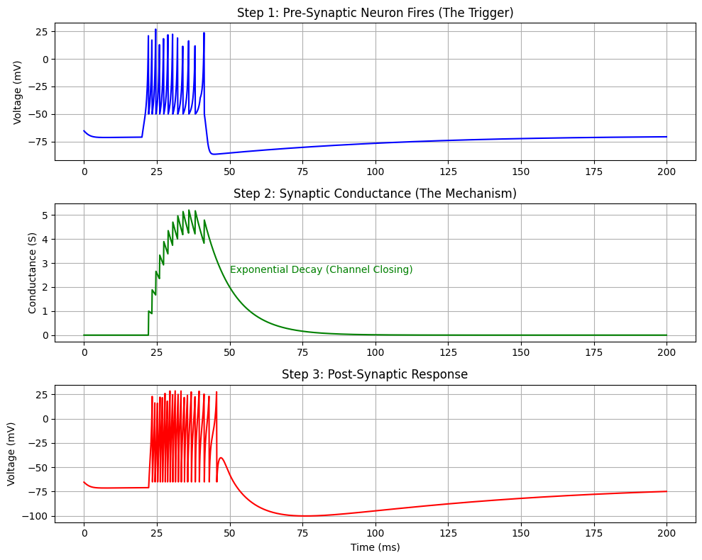
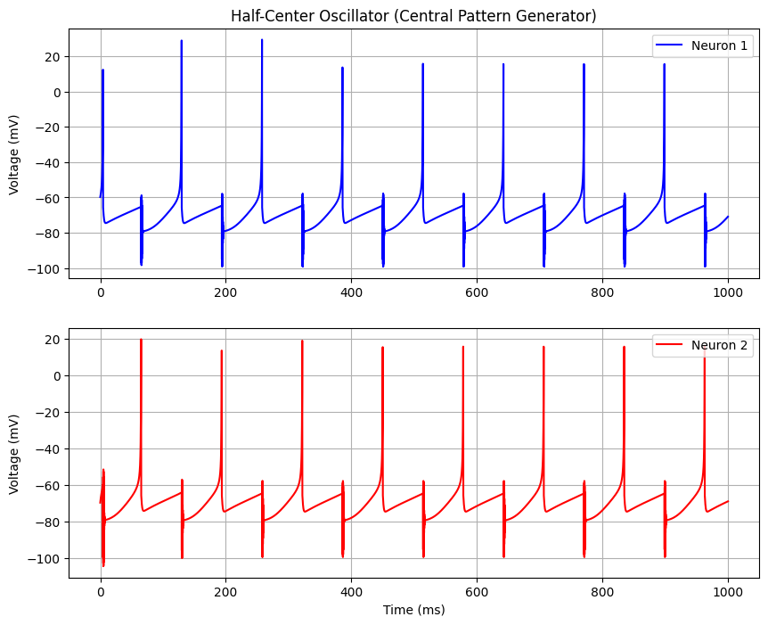

Project: A Small Spiking Neural Network from Scratch

Synaptic Physics: Conductance-based synaptic dynamics for a two-neuron system.

Emergent Behavior: A Half-Center Oscillator system created by mutual inhibition between two neurons.

